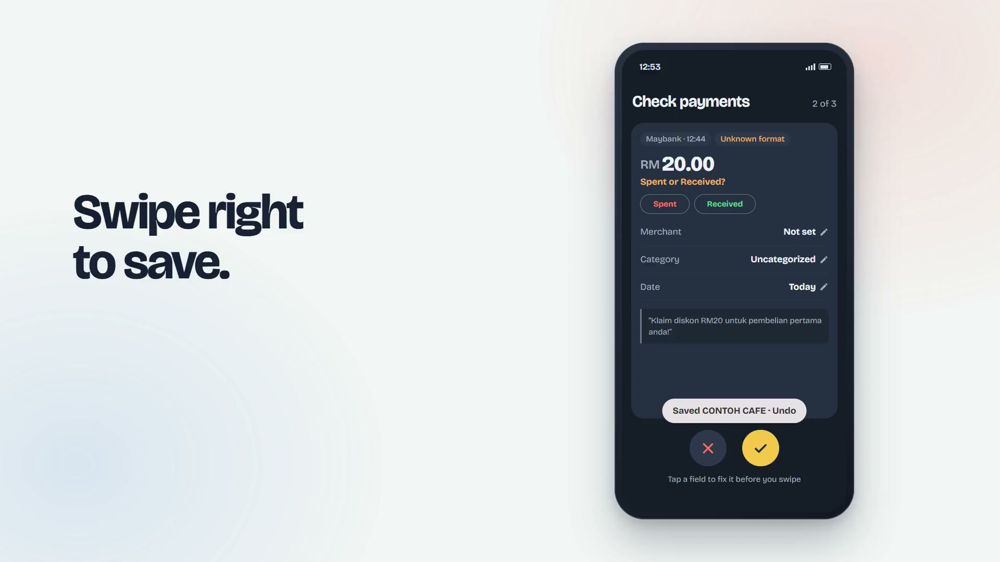
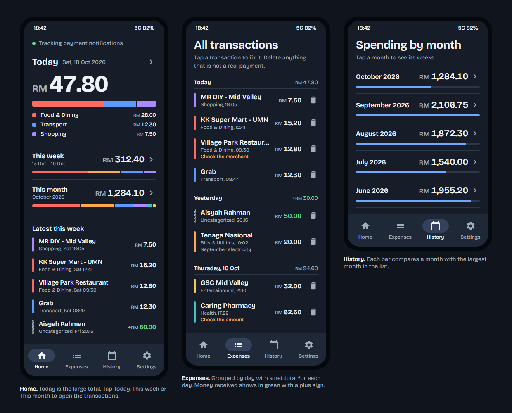
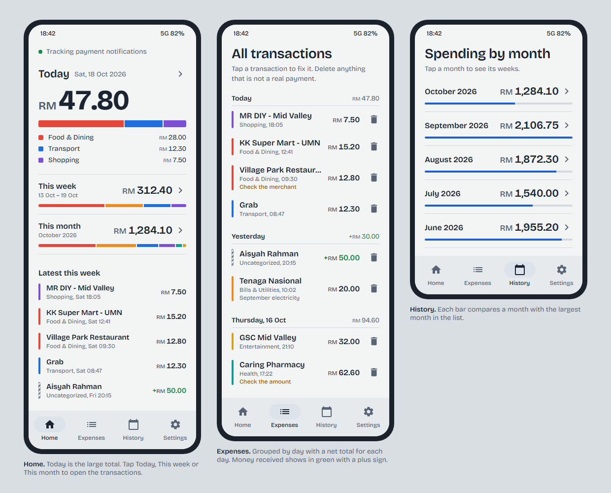

# Koban

Android app that tracks spending by reading bank and wallet payment notifications on your phone.

[Overview](#overview) • [Demo](#demo) • [Features](#features) • [Getting started](#getting-started) • [Build](#build) • [Privacy](#privacy--security) • [Troubleshooting](#troubleshooting)


## Overview

Koban listens to payment alerts from the banking and e-wallet apps you pick. Regex rules read the amount, merchant and direction, and the payment waits on a swipe screen: swipe right to save it, swipe left to drop it. Nothing counts in your totals until you say yes. You get day / week / month spending with categories, bill splits from a receipt photo, and a list of who owes you — without typing every purchase by hand.

It is built for Malaysian Ringgit notifications (`RM` / `MYR`). Maybank and Touch 'n Go have exact rules; other apps use a generic rule. The default build makes no network call to read a notification. [Google AI Studio](https://aistudio.google.com/) Gemini is optional: it can pre-fill cards and it reads receipt photos.

```text
Bank / wallet notification (apps you picked)
        │
        ▼
NotificationListenerService
        │
        ▼
Regex rules: exact per-app rule ──► generic RM/MYR rule ──► no amount: skip
        │
        ▼
Waiting payment (on device, not in any total)
        │   └─ optional: Gemini pre-fills merchant / category, tags "Likely promotion"
        ▼
Swipe screen: right = save, left = drop, 4 s Undo
        ▼
Room database (on device)
        ▼
Home · Activity · People · Settings
```

## Demo

A 21-second demo with sound: a payment notification becomes an expense, spending by category, a bill split from a receipt photo, and a repayment confirmed. Click the image to play it. The video and screenshots are from before the swipe screen, when payments were saved without a check.

[](docs/demo/koban-demo.mp4)

Home, Expenses and History in dark mode (the default) and light mode. All merchants and amounts are sample data.



<details>
<summary>Light mode</summary>



</details>

Each spending category takes the color of a ringgit note (RM10 red, RM1 blue, RM100 purple, RM20 orange, RM50 teal, gold foil). Uncategorized spending shows as stripes.

## Features

- **Automatic capture** — reads payment notifications via Android’s `NotificationListenerService`, from the payment apps you pick
- **Regex rules** — exact rules for Maybank and Touch 'n Go; any other text with an `RM` / `MYR` amount becomes a card marked **Unknown format**. Works offline, no API key
- **Swipe to confirm** — every captured payment waits on a card. Swipe right (or ✓) to save, left (or ✕) to drop, with a 4-second **Undo**. Edit amount, merchant, category, date or direction on the card first
- **Optional Gemini pre-fill** — off by default; with your own key, Gemini (3.1 / 3.5 Flash Lite, with rate-limit failover) fills merchant and category and tags **Likely promotion**. It never saves anything by itself
- **Duplicate protection** — skips the same payment when it arrives from multiple apps or twice within a short window; a dropped payment does not come back
- **Spending views** — day / week / month totals with a category donut, money received, and an All view
- **Bill splits** — read a receipt photo (needs a Gemini key), tap who had what; only your share counts as spending
- **People** — track who owes you and whom you owe, store a friend's payment QR, and get a suggested match when a repayment arrives
- **Background reliability** — keep-alive service, boot restart, and reconnect helpers (including Xiaomi/HyperOS guidance)
- **Debug log** — inspect every notification the listener saw and why it was captured or skipped

## Getting started

### Prerequisites

- [Android Studio](https://developer.android.com/studio) (or JDK 17 + Android SDK)
- A physical Android device (API 26+). Emulators rarely receive real bank notifications.
- Notification access permission for the app

### Run the app

1. Clone the repository and open it in Android Studio.
2. Sync Gradle, then run on your device (`Run` or `./gradlew.bat installDebug`).
3. Grant **Notification access**:
   - Android Settings → Apps → Special app access → **Notification access** → enable **Koban**
4. Tick your payment apps in the list Koban shows. Maybank and Touch 'n Go start ticked when installed. Change the list later in **Settings → Payment apps**. An empty list means Koban listens to no app.
5. On Xiaomi/HyperOS, follow the in-app battery/autostart checklist in **Settings** so the listener is not killed.

> [!TIP]
> After a real transfer or Scan & Pay, open Koban. The swipe screen opens by itself, and Home shows "1 payment to check". **Settings → Notification log** shows the notification as **Waiting for check**. Use **Settings → Test parse** to try a notification text without a payment.

### Optional: Google AI Studio (Gemini)

Gemini is off by default. With a key it does two things: it pre-fills merchant and category on waiting cards and tags likely promotions, and it reads receipt photos for bill splits. Without a key, capture works the same, and receipt scanning asks for a key.

Turn it on in **Settings → Gemini (optional)**: switch on **Use Gemini to pre-fill** and paste your key into **Gemini API key**. The key is stored in app-private storage that is excluded from Android backup.

Defaults cycle between [`gemini-3.1-flash-lite`](https://ai.google.dev/gemini-api/docs/models/gemini-3.1-flash-lite) and [`gemini-3.5-flash-lite`](https://deepmind.google/models/gemini/flash-lite/) when one hits a rate limit.

For your own build, you can also put a default key in `.env`:

1. Copy the example env file:

   ```bash
   cp .env.example .env
   ```

2. Edit `.env`:

   ```env
   GEMINI_API_KEY=your-google-ai-studio-key
   GEMINI_MODEL_PRIMARY=gemini-3.1-flash-lite
   GEMINI_MODEL_SECONDARY=gemini-3.5-flash-lite
   ```

3. Rebuild the app so Gradle injects the key into `BuildConfig`. It becomes the default value of the key field; the switch still starts off.

> [!IMPORTANT]
> Never commit `.env` or built APKs. The API key is compiled into the debug APK via `BuildConfig` and can be extracted from a distributed binary. Fine for personal builds; use a backend proxy before any public release.

Get a key at [Google AI Studio](https://aistudio.google.com/apikey).

## Build

Windows (PowerShell):

```powershell
.\gradlew.bat test assembleDebug
```

macOS / Linux:

```bash
./gradlew test assembleDebug
```

Debug APK output:

```text
app/build/outputs/apk/debug/app-debug.apk
```

Install over USB:

```bash
adb install -r app/build/outputs/apk/debug/app-debug.apk
```

## Architecture

| Area | Stack |
|------|--------|
| UI | Jetpack Compose, Material 3, Navigation |
| DI | Hilt |
| Storage | Room (expenses, categories), DataStore (settings) |
| Listener | `NotificationListenerService` + foreground keep-alive |
| Parsing | Regex rules (`PaymentRules`, `NotificationParser`); optional Gemini via OkHttp for pre-fill and receipts |
| Min SDK | 26 · Target / Compile SDK 35 |

Key packages under `app/src/main/java/com/expensetracker/app/`:

- `listener/` — notification capture, reconnect, OEM battery helpers
- `parser/` — regex rules, Gemini client, receipt reader, amount formatting, dedup keys
- `data/` — Room entities, DAOs, repositories
- `ui/` — screens, view models, components

## Privacy & security

- Expense data stays **on device** in a local Room database.
- Notification text is read on device by regex. The default build sends nothing to a server.
- With **Use Gemini to pre-fill** on, the text of each waiting payment is sent to Google AI Studio (Gemini). Receipt photos go to Gemini when you scan one.
- `.env` is gitignored. Do not publish APKs that contain a personal API key.

## Troubleshooting

| Issue | What to try |
|-------|-------------|
| Nothing is tracked | Confirm notification access is enabled; check that **Settings → Payment apps** is not empty; check **Notification log** |
| Listener dies when app is closed | Disable battery restrictions; enable autostart (Xiaomi); keep the persistent tracking notification |
| Duplicate expenses | Update to the latest build; dismiss old duplicates manually — new ones should be blocked within ±5 minutes for the same amount |
| Promos show on the swipe screen | Swipe them left. With Gemini on, they get a **Likely promotion** tag |
| Xiaomi reconnect fails | Prefer soft reconnect / checklist in Settings; avoid repeatedly toggling notification access |

> [!NOTE]
> On aggressive OEMs (especially HyperOS), locking the app in Recents and setting battery to **No restrictions** makes tracking far more reliable.

## FAQ

**Does the app need to stay open?**  
It should keep listening in the background via the notification listener and keep-alive service, but OEM battery policies can still stop it. Use the Settings checklist on Xiaomi devices.

**Will it work without Gemini / Google AI Studio?**  
Yes. Capture is regex only and needs no key. Without a key you lose the pre-fill and receipt scanning.

**Why confirm every payment?**  
Automatic saving let promotions through and put dates into merchant names. A swipe takes a second, and nothing wrong reaches your totals.

**Can two real purchases of the same amount be merged?**  
Possibly, if they happen within about five minutes with the same amount and direction. That tradeoff avoids double-counting one payment that both the bank and the wallet report.
