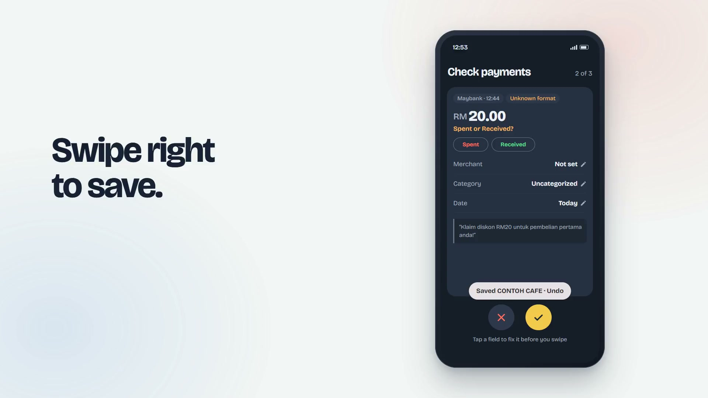

# Koban

Android app that tracks spending by reading bank and wallet payment notifications on your phone.

[Overview](#overview) • [Demo](#demo) • [Features](#features) • [Getting started](#getting-started) • [Build](#build) • [Architecture](#architecture) • [Privacy](#privacy) • [Troubleshooting](#troubleshooting) • [FAQ](#faq)


## Overview

Koban reads payment alerts from the bank and e-wallet apps that you pick. Regex rules find the amount, the shop and the type (Spent or Received). Each payment then waits in **Check payments**. Swipe right to save it, or swipe left for **Not a payment**. A payment counts in your totals only after you save it.

Koban also splits bills from a receipt photo, keeps a list of who owes you, and lets you compare category totals with friends in groups.

Koban is built for Malaysian Ringgit notifications (`RM` and `MYR`). Maybank and Touch 'n Go have exact rules. Other apps use a generic rule. Koban reads the notification text on the phone and never sends it to a server.

The app is written in Flutter, in [`koban/`](koban/). The latest release is 0.3.0, with a warmer look and a faster bill split. Version 0.2.0 was the first Flutter release. Versions 0.1.0 and 0.1.1 came from the Kotlin app in [`app/`](app/), which is now legacy code.

```text
Bank or wallet notification (only the apps you picked)
        │
        ▼
ExpenseNotificationListener (Kotlin NotificationListenerService)
skips other apps, summary notifications and empty text
        │
        ▼
CaptureQueue (SQLite queue on the phone, kept until Dart handles each row)
        │  CaptureEngine wakes a Flutter engine with no screen
        ▼
captureMain → CaptureWorker (background Dart)
        │
        ▼
PaymentRules: exact rule for the app ──► generic RM/MYR rule ──► no amount: skip
        │
        ▼
Duplicate check, then a waiting payment in the drift database (not in any total)
        │
        ▼
Check payments: swipe right = Save payment, swipe left = Not a payment, 4 s Undo
        │
        ▼
Home · Activity · People · Groups
```

## Demo

The demo video and its cover image come from the Kotlin app, version 0.1. The Flutter app has the same capture and check flow. Its look and its split flow are new since 0.3.0. [docs/prototypes/warmer-ui/](docs/prototypes/warmer-ui/) has the design mockups of the new look.

The 37-second video has sound. It shows a payment notification that Koban reads, a swipe to save it and a swipe to drop a promotion, spending by month and week, a cash payment on a number pad, a bill split from a receipt photo, and who owes you. All data is made up.

[](docs/demo/koban-demo.mp4)

## Features

### Capture and check

- **Automatic capture.** Koban reads notifications only from the apps that you tick in **Payment apps**. Maybank and Touch 'n Go start ticked when they are installed. An empty list means that Koban reads no app.
- **Regex rules.** Exact rules read Maybank and Touch 'n Go alerts. Any other text with an `RM` or `MYR` amount becomes a card with a guessed shop. The rules run on the phone and need no API key.
- **Check payments.** Each found payment waits on a card. Tap a field to fix the amount, shop, category, date or type. Swipe right or tap **Save payment** to keep it. Swipe left or tap **Not a payment** to drop it. Both actions have a 4-second **Undo**.
- **Duplicate protection.** Koban skips a payment that it already has: the same notification, the same app and amount in one 30-minute bucket, or the same amount and type within 5 minutes. A payment that you drop does not come back for 30 days.
- **Background tracking.** A small persistent notification keeps Android from stopping the listener. Tracking starts again after a phone restart and after an app update. **Settings** has battery and Xiaomi autostart shortcuts.
- **Notification log.** **Settings → Notification log** shows each notification that Koban saw and what Koban did with it. **Test parse** in Settings reads a sample text without a real payment.

### Money views

- **Home** greets you by the time of day. It shows what you spent this week with a bar for each day, the payments that wait in Check payments, and the latest payments of this week.
- **Activity** shows one month at a time, or all payments. Pick one week of the month with the week chips. It has a bar of spending by category, a search by shop or note, and a category filter.
- **Add payment** adds a cash payment by hand.
- **Categories.** The built-in categories take the colors of ringgit notes: Food is red (RM10), Transport is blue (RM1), Shopping is purple (RM100), Bills is orange (RM20), Health is teal (RM50) and Entertainment is green (RM5). You can add your own categories in **Settings**.

### Splits and people

- **Bill splits.** First tap the people who ate with you. Then take a photo of the receipt or pick one from the gallery, and Koban reads the items on the phone with ML Kit. You can also add items by hand from a quick sheet, with the recent items of that shop and a number pad with a `×` key. You mark who had each item as you add it. A meter shows what is not split yet, and **Split the rest evenly** shares it. Service charge and tax are percent chips, and a rounding gap of up to 5 sen fills itself. Only your share counts as your spending. You can also split one amount with no receipt.
- **Read with Claude (optional).** With an invite code from the owner, Koban also sends the receipt photo to Claude and uses the read that matches the printed total. Each phone has 10 Claude reads a day. See [Privacy](#privacy).
- **People.** See who owes you and whom you owe. Store a friend's payment QR, save it to the gallery, and pay from your bank app. Send a reminder through the share menu. When a Received payment matches an open debt, Koban suggests the match.

### Groups

- **Groups** compare spending with friends. Sign in with Google, make a group and share its code, or ask to join a friend's group. The group owner approves each request.
- Members see each other's totals per category, for each week and month. Single payments, shops, times, notes and money in are never shared. To keep one payment out of the group totals, turn off **Count in group totals** on that payment.
- You can be in up to 5 groups. Each group has up to 10 members.
- **Delete account** removes you from all groups and deletes your shared totals from the server. The payments on your phone stay.
- Groups use the invite code from **Settings**.

### App

- **Onboarding** on first start: notification access, payment apps, and the battery settings that your phone needs.
- **Self-updater.** Once a day, Koban checks the latest GitHub release and shows **Update available**. The update is optional. Koban installs only an APK with the Koban app ID and the expected version code. **Settings → Check for updates** checks at once.
- **Online features** switch in **Settings**. It is on by default. When it is off, Koban makes no network calls: groups, Claude reads and update checks stop.
- **Import of 0.1.1 data.** When 0.2.0 installs over the Kotlin 0.1.1 app, the first start copies the old database rows and settings into the new database. Koban keeps the old database file under a `.pre-flutter` name.
- **Look.** Each screen starts with a teal band where Mon, a gold koban coin, sits on a pile of coins and says one short line. Mon looks calm, happy or worried to match the screen. The tab bar floats at the bottom as a dark pill. Gold marks the one main action on each screen. Big totals and titles use Bricolage Grotesque, and all other text uses Nunito, a round font that is easy to read. Light mode is the default. Turn on dark mode in **Settings**. [docs/DESIGN.md](docs/DESIGN.md) has the full design rules and the app's word list.

## Getting started

### Install the app

Koban is for the owner and invited friends. The owner installs the first APK by USB, as section 7 of [docs/RELEASING.md](docs/RELEASING.md) tells. Later updates come through the app. Android Play Protect can block an APK that asks for notification access when it comes from a browser or a chat app.

### Set up the phone

1. Open Koban. Onboarding opens by itself.
2. Turn on **Notification access** for Koban.
3. Tick your payment apps. Change the list later in **Settings → Payment apps**.
4. Follow the battery steps that Koban shows. On Xiaomi and HyperOS, turn on Autostart and set battery to **No restrictions**.
5. To read receipts with Claude or to use groups, enter your invite code in **Settings → Invite code**.

> [!TIP]
> After a real transfer or Scan & Pay, open Koban. **Check payments** opens by itself, and Home shows the waiting payment. **Settings → Notification log** shows the notification as **Waiting in Check payments**.

### Prerequisites for development

- [Flutter](https://docs.flutter.dev/get-started/install) 3.47 or later (Dart 3.14)
- JDK 17 and the Android SDK
- A physical Android phone, API 26 or later. Emulators rarely receive real bank notifications.
- For groups and Claude reads, a root `.env` file with `SUPABASE_KEY`. Copy [`.env.example`](.env.example) and ask the owner for the key. Without the key, the build shows a warning, and groups and Claude reads do not work.

## Build

Run all commands from `koban/`. Set `JAVA_HOME` to your JDK 17.

Get the packages and run the checks:

```bash
flutter pub get
flutter analyze
flutter test
(cd android && ./gradlew :app:testDebugUnitTest)
```

Flutter makes `android/gradlew` at the first `flutter run` or `flutter build`. On Windows, use `gradlew.bat`. Run `:app:testDebugUnitTest`, not the plain `testDebugUnitTest`: the plain task also runs the tests of a plugin, and they fail.

Run a debug build on a phone that is connected by USB:

```bash
flutter run
```

A debug build has the app ID `io.github.skooyo.koban.debug`, so it installs next to the release app. Google sign-in works only in builds whose key SHA-1 is in the owner's Google Cloud OAuth clients.

After a change to a `.drift` file or to `lib/data/database.dart`, make `lib/data/database.g.dart` again:

```bash
dart run build_runner build
```

The release build is `flutter build apk --release`. Its output is `build/app/outputs/flutter-apk/app-release.apk`. A release build needs the owner's release key. To release a new version, follow [docs/RELEASING.md](docs/RELEASING.md).

GitHub Actions runs `flutter analyze` and `flutter test` on each push and pull request that changes `koban/`.

## Architecture

| Area | Stack |
|------|--------|
| UI | Flutter, Material 3, Bricolage Grotesque and Nunito fonts |
| Storage | drift on SQLite (payments, categories, people, splits), `shared_preferences` (settings) |
| Capture | Kotlin `NotificationListenerService`, a foreground keep-alive service, a SQLite queue, and a background Dart engine |
| Rules | Pure Dart regex rules (`PaymentRules`, `NotificationParser`) and the receipt rule engine (`ReceiptRules`) |
| Receipts | `google_mlkit_document_scanner` and `google_mlkit_text_recognition` on the phone, `image_picker` for the gallery and the camera |
| Online | `supabase` (auth, tables, Edge Functions), `google_sign_in`, `http` |
| Updates | GitHub latest-release API, Android package installer |
| Min SDK | 26 |

Key folders:

- `koban/lib/capture/` has the background Dart entry point (`captureMain`) and the worker that reads the native queue.
- `koban/lib/rules/` has the pure Dart rules: payments, receipts, splits, dedup keys and repayment matches.
- `koban/lib/data/` has the drift database, the repositories, and the one-time import of 0.1.1 data.
- `koban/lib/screens/` has one folder per screen, each with a screen and a view model.
- `koban/lib/online/` has groups, Google sign-in, the Supabase client and the Claude receipt client.
- `koban/lib/update/` has the self-updater.
- `koban/android/app/src/main/kotlin/` has the native listener, the capture queue, the keep-alive service and the APK installer.
- `supabase/` has the database migrations and the Edge Functions `register`, `read-receipt` and `delete-account`.
- `server/receipt-service/` has the receipt service that runs Claude on the owner's server.
- `app/` has the legacy Kotlin and Jetpack Compose app (0.1.0 and 0.1.1). Do not release it again.

## Privacy

Koban keeps your data on the phone. Some features use the internet, and only when **Online features** is on. The switch is on by default.

These stay on the phone at all times:

- The notification text, and the regex rules that read it.
- Your payments, shops, notes, categories, people, debts, splits and payment QRs, in the local drift database.
- Receipt photos that ML Kit reads.

These go online, and only when **Online features** is on:

- **Update check.** Once a day, Koban asks the GitHub API for the latest release. The request has no token, no app version and no account ID. A new APK downloads only when you tap **Update**.
- **Invite code.** Koban sends the code to Koban's Supabase server and gets a device token back. The server keeps a hash of the token.
- **Claude reads.** With an invite code, Koban makes the receipt photo smaller and sends it to the `read-receipt` Edge Function. The function sends the photo to the receipt service on the owner's server. The service runs Claude and deletes the photo after the read. The server counts the reads per phone for the daily limit.
- **Groups.** When you sign in with Google, the server keeps your Google account and a name for groups (your Google first name, which you can change). It also keeps your groups and your Spent totals per category, for each week and month since you joined your first group. Single payments, shops, times, notes and money in never leave the phone. Payments with **Count in group totals** off are not in the totals.

When you turn off **Online features**, Koban makes no network calls.

The repository is public. `.env` is in `.gitignore`. Do not commit a key, a password or a server URL.

## Troubleshooting

| Issue | What to try |
|-------|--------|
| Nothing is tracked | Make sure that notification access is on. Make sure that **Settings → Payment apps** is not empty. Look in **Settings → Notification log**. |
| The listener stops when the app is closed | Set battery to **No restrictions**. Turn on Autostart on Xiaomi. Keep the persistent tracking notification. Tap **Restart payment tracking** in Settings. |
| The same payment shows twice | Delete the extra payment. Koban blocks a second payment with the same amount and type within 5 minutes. |
| A promotion shows in Check payments | Swipe it left for **Not a payment**. |
| Claude does not read receipts | Turn on **Online features**. Enter an invite code in **Settings**. Each phone has 10 Claude reads a day. The limit resets at midnight, Malaysia time. |
| Google sign-in fails | Add a Google account to the phone. Enter your invite code in **Settings** first. |
| "Could not check for updates" | GitHub allows 60 checks per hour from one IP address. Try again later. |
| Koban closes after an update | Android closes the app after a self-update. Open Koban again. |

> [!NOTE]
> On Xiaomi and HyperOS, lock Koban in Recents and set battery to **No restrictions**. Do not use "Clear all" in Recents: it can turn off notification access.

## FAQ

**Does the app need to stay open?**
No. After you turn on notification access, a small persistent notification keeps Android from stopping the listener. Some phones still stop it. Use the battery steps in Settings.

**Why check every payment?**
Automatic saving let promotions through and put dates into shop names. A swipe takes a second, and no wrong payment reaches your totals.

**Can Koban merge two real payments of the same amount?**
Yes, if both are Spent payments of the same amount within about 5 minutes. Koban accepts this risk so that it does not count one payment twice when the bank and the wallet both report it. Received payments from different senders are not merged.

**Does Koban work without the internet?**
Yes. Capture, Check payments, People, and splits that ML Kit reads work offline. Groups, Claude reads and update checks need the internet.

**Does Koban work on iPhone?**
No. Koban ships only as an Android APK.
