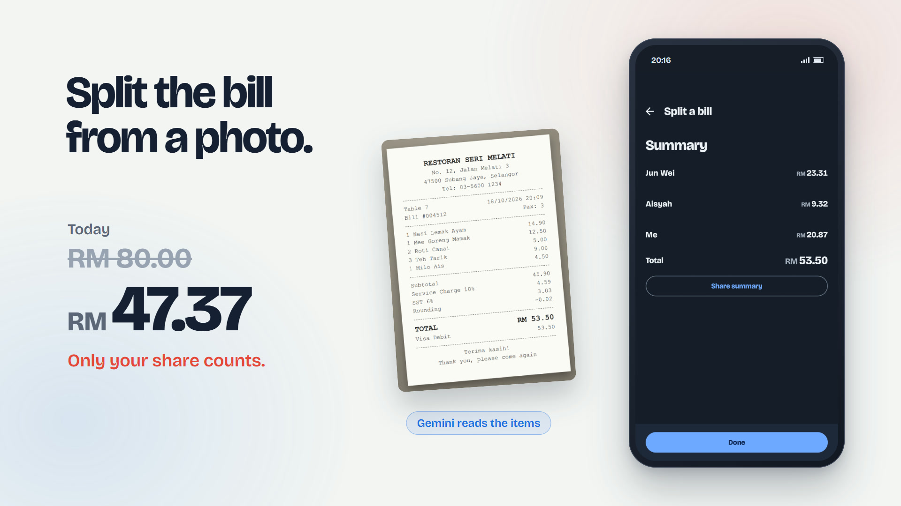
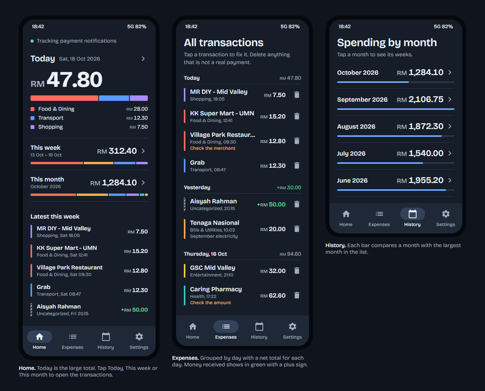
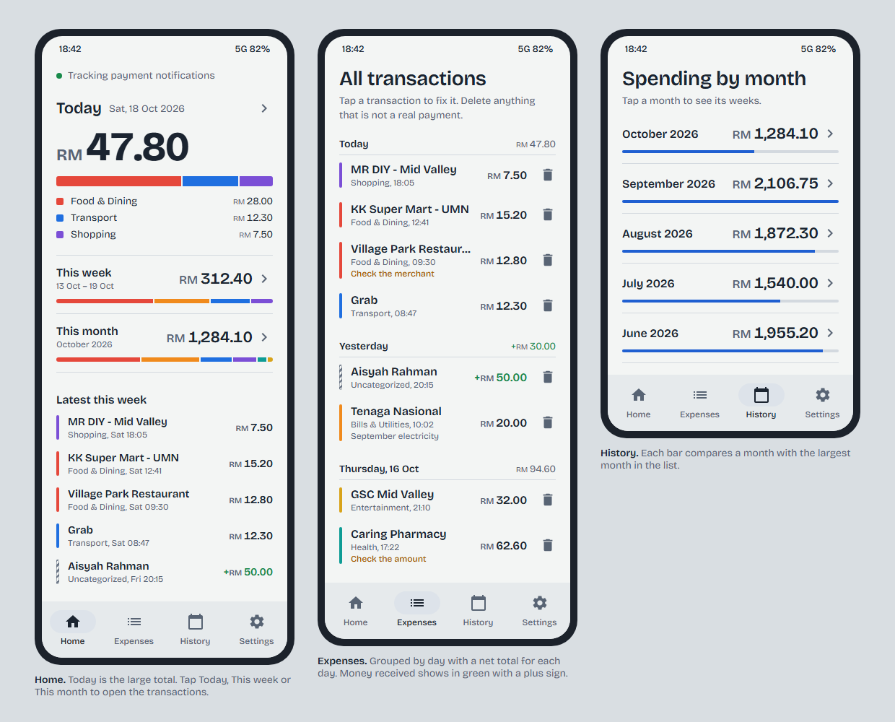

# Koban

Android app that tracks spending by reading bank and wallet payment notifications on your phone.

[Overview](#overview) • [Demo](#demo) • [Features](#features) • [Getting started](#getting-started) • [Build](#build) • [Privacy](#privacy--security) • [Troubleshooting](#troubleshooting)


## Overview

Koban listens to payment alerts from banking and e-wallet apps, extracts the amount and merchant, and saves them as expenses automatically. You get day / week / month spending summaries with categories — without typing every purchase by hand.

It is built for Malaysian Ringgit notifications (`RM` / `MYR`), with optional [Google AI Studio](https://aistudio.google.com/) Gemini parsing for better merchant extraction and filtering out promotional messages that only mention money amounts.

```text
Bank / wallet notification
        │
        ▼
NotificationListenerService
        │
        ├── LLM parse (Gemini Flash Lite)  ──► real transaction?
        │         │  (3.1 ↔ 3.5 on rate limit)   │
        │         └─ fallback ──► regex          └─ skip promo / OTP / etc.
        ▼
Room database (on device)
        ▼
Home · Expenses · History · Settings
```

## Demo

A 21-second demo with sound: a payment notification becomes an expense, spending by category, a bill split from a receipt photo, and a repayment confirmed. Click the image to play it.

[](docs/demo/koban-demo.mp4)

Home, Expenses and History in dark mode (the default) and light mode. All merchants and amounts are sample data.



<details>
<summary>Light mode</summary>



</details>

Each spending category takes the color of a ringgit note (RM10 red, RM1 blue, RM100 purple, RM20 orange, RM50 teal, gold foil). Uncategorized spending shows as stripes.

## Features

- **Automatic capture** — reads payment notifications via Android’s `NotificationListenerService`
- **Smart parsing** — optional Gemini (3.1 / 3.5 Flash Lite) extracts amount, merchant, and transaction direction; rejects promos that aren’t real payments
- **Rate-limit failover** — if one Gemini model is rate-limited, the other is tried automatically
- **Regex fallback** — works offline or without an API key using RM/MYR pattern matching
- **Duplicate protection** — skips the same payment when it arrives from multiple apps or twice within a short window
- **Spending views** — today / this week / this month totals with category breakdown
- **Categories & notes** — edit expenses, assign categories, dismiss false positives
- **Allowlist** — optionally limit tracking to specific payment app packages
- **Background reliability** — keep-alive service, boot restart, and reconnect helpers (including Xiaomi/HyperOS guidance)
- **Debug log** — inspect every notification the listener saw and why it was saved or skipped

## Getting started

### Prerequisites

- [Android Studio](https://developer.android.com/studio) (or JDK 17 + Android SDK)
- A physical Android device (API 26+). Emulators rarely receive real bank notifications.
- Notification access permission for the app

### Run the app

1. Clone the repository and open it in Android Studio.
2. Sync Gradle, then run on your device (`Run` or `./gradlew.bat installDebug`).
3. Grant **Notification access**:
   - Android Settings → Apps → Special app access → **Notification access** → enable **Koban**
4. Open the app **Settings** tab:
   - Leave the allowlist empty to track all apps, or add your bank/wallet package names
   - On Xiaomi/HyperOS, follow the in-app battery/autostart checklist so the listener is not killed

> [!TIP]
> After a real transfer or Scan & Pay, check **Settings → Notification log**. You should see the notification marked **Saved**, or **Not transaction** if the LLM classified it as a promo.

### Optional: Google AI Studio (Gemini) parsing

LLM parsing improves merchant names and filters promotional RM amounts. Without a key, the app falls back to regex.

Defaults cycle between [`gemini-3.1-flash-lite`](https://ai.google.dev/gemini-api/docs/models/gemini-3.1-flash-lite) and [`gemini-3.5-flash-lite`](https://deepmind.google/models/gemini/flash-lite/) when one hits a rate limit.

1. Copy the example env file:

   ```bash
   cp .env.example .env
   ```

2. Edit `.env`:

   ```env
   GEMINI_API_KEY=your-google-ai-studio-key
   GEMINI_MODEL_PRIMARY=gemini-3.1-flash-lite
   GEMINI_MODEL_SECONDARY=gemini-3.5-flash-lite
   ```

3. Rebuild the app so Gradle injects the key into `BuildConfig`.

> [!IMPORTANT]
> Never commit `.env` or built APKs. The API key is compiled into the debug APK via `BuildConfig` and can be extracted from a distributed binary. Fine for personal builds; use a backend proxy before any public release.

Get a key at [Google AI Studio](https://aistudio.google.com/apikey).

## Build

Windows (PowerShell):

```powershell
.\gradlew.bat test assembleDebug
```

macOS / Linux:

```bash
./gradlew test assembleDebug
```

Debug APK output:

```text
app/build/outputs/apk/debug/app-debug.apk
```

Install over USB:

```bash
adb install -r app/build/outputs/apk/debug/app-debug.apk
```

## Architecture

| Area | Stack |
|------|--------|
| UI | Jetpack Compose, Material 3, Navigation |
| DI | Hilt |
| Storage | Room (expenses, categories), DataStore (settings) |
| Listener | `NotificationListenerService` + foreground keep-alive |
| Parsing | Google AI Studio Gemini (OkHttp) → regex fallback |
| Min SDK | 26 · Target / Compile SDK 35 |

Key packages under `app/src/main/java/com/expensetracker/app/`:

- `listener/` — notification capture, reconnect, OEM battery helpers
- `parser/` — LLM + regex parsing, amount formatting, dedup keys
- `data/` — Room entities, DAOs, repositories
- `ui/` — screens, view models, components

## Privacy & security

- Expense data stays **on device** in a local Room database.
- Notification text is processed on device; with LLM enabled, notification body text is sent to Google AI Studio (Gemini) for parsing.
- `.env` is gitignored. Do not publish APKs that contain a personal API key.

## Troubleshooting

| Issue | What to try |
|-------|-------------|
| Nothing is tracked | Confirm notification access is enabled; check **Notification log** |
| Listener dies when app is closed | Disable battery restrictions; enable autostart (Xiaomi); keep the persistent tracking notification |
| Duplicate expenses | Update to the latest build; dismiss old duplicates manually — new ones should be blocked within ±5 minutes for the same amount |
| Promos saved as expenses | Enable LLM parsing with a valid Gemini API key and rebuild |
| Xiaomi reconnect fails | Prefer soft reconnect / checklist in Settings; avoid repeatedly toggling notification access |

> [!NOTE]
> On aggressive OEMs (especially HyperOS), locking the app in Recents and setting battery to **No restrictions** makes tracking far more reliable.

## FAQ

**Does the app need to stay open?**  
It should keep listening in the background via the notification listener and keep-alive service, but OEM battery policies can still stop it. Use the Settings checklist on Xiaomi devices.

**Will it work without Gemini / Google AI Studio?**  
Yes. Regex parsing still extracts RM/MYR amounts. Merchant names and promo filtering will be less accurate.

**Can two real purchases of the same amount be merged?**  
Possibly, if they happen within about five minutes with the same amount and direction. That tradeoff avoids double-counting bank push + SMS pairs for one payment.
